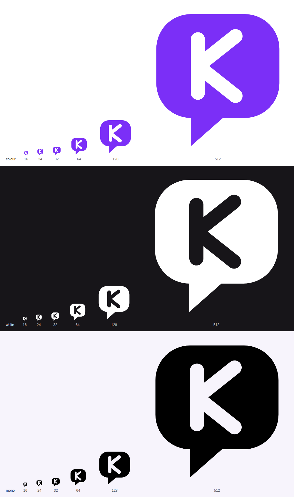

# Krivo ChatFlow — identidade visual (PROVISÓRIA)

> **Status: provisório.** Desenho original, criado como *placeholder* até a Krivo fornecer o símbolo oficial
> (o “K” e as formas da linguagem visual Krivo). Serve para desenvolver o plugin, o menu do admin e a
> primeira versão dos ícones. **Não** é a marca final.



## Conceito

Um **balão de conversa** cujo **espaço negativo forma um K**.
Regra de construção: a borda esquerda do talo do K é **a mesma linha vertical** da borda esquerda da cauda,
então o talo “continua” na cauda. Cor chapada (sem gradiente), um único *path* composto por arquivo —
funciona como máscara CSS, como ícone do menu do WordPress e em uma cor só.

- Silhueta: quadrado arredondado com cauda angular. **Não** é círculo com cauda, **não** tem telefone e **não**
  usa nenhum elemento do logotipo do WhatsApp (marca de terceiros; diretriz 17 do WordPress.org).
- Grade 96 × 96, raio 22, K com terminais arredondados.

## Dois tamanhos ópticos

| Desenho | Quando usar | Por quê |
|---------|-------------|---------|
| **principal** (`-symbol`) | **≥ 32 px** | Traço 9, proporções refinadas |
| **small** (`-symbol-small`) | **≤ 24 px** (16, 20, 24) | Traço 12 e K mais alto: haste, braço e perna continuam distintos em 16 px |

`previews/small-sizes-zoom.png` mostra a comparação em pixels reais (ampliados 8×, vizinho mais próximo).
Abaixo de **16 px** a marca não deve ser usada.

## Arquivos

| Arquivo | Uso |
|---------|-----|
| `krivo-chatflow-symbol.svg` · `-small.svg` | Símbolo colorido (`#7B2FF7`) sobre fundo claro |
| `krivo-chatflow-symbol-white.svg` · `-small.svg` | Símbolo branco, para fundos escuros ou roxos (o K mostra o fundo) |
| `krivo-chatflow-symbol-mono.svg` · `-small.svg` | Uma cor, herda `currentColor` (documentos, carimbos, favicon monocromático) |
| `krivo-chatflow-icon.svg` | Ícone de aplicativo/plugin: tile roxo + balão branco |
| `krivo-chatflow-logo.svg` · `-white.svg` | Lockup horizontal “Krivo ChatFlow” (claro / escuro) |
| `krivo-chatflow-menu-icon.svg` | **Menu do wp-admin** (20 px, desenho *small*, `fill="#a7aaad"` na raiz para o esquema de cores do admin) |
| `export/icon-128x128.png` · `icon-256x256.png` | Tamanhos de ícone do WordPress.org (transparentes) |
| `export/symbol-512.png` | Símbolo em 512 px (transparente) |
| `previews/` | Folha de tamanhos (16/24/32/64/128/512), zoom dos tamanhos pequenos, lockup, menu do admin em 20 px |
| `tools/build_logo.py` | **Fonte da verdade**: gera todos os SVG e previews (`build` / `preview`) |

## Cor e contraste (valores calculados)

| Uso | Cor | Contraste |
|-----|-----|-----------|
| Símbolo / tile | `#7B2FF7` | 5,85:1 sobre branco · 5,37:1 sobre `#F7F4FC` |
| Texto do lockup | `#171519` | 16,67:1 sobre `#F7F4FC` |
| Versão branca | `#FFFFFF` | sobre `#171519` |

`#A14DFF` (cor principal Krivo) **não** é usada no símbolo: branco sobre ela dá 4,18:1, abaixo do mínimo de 4,5:1 para
texto normal. Fica reservada a elementos gráficos grandes e decoração (ver `docs/04`, seção 4.4).

## Regras de uso

- **Área de respiro**: no mínimo 12 % da altura do símbolo em todos os lados.
- **Tamanho mínimo**: 16 px (use o desenho *small* até 24 px).
- **Não** aplicar degradê, sombra, contorno, rotação, distorção ou outras cores; **não** trocar o K por outra letra;
  **não** combinar com glifos de terceiros (WhatsApp, Meta etc.).
- O lockup usa o *wordmark* convertido em curvas a partir da **Liberation Sans** (SIL Open Font License 1.1),
  para o SVG não depender de fontes instaladas. É provisório: a tipografia final virá com a marca oficial.

## Como entra no plugin

| Onde | Como | Marco |
|------|------|-------|
| Menu do wp-admin | `krivo-chatflow-menu-icon.svg` em Base64 (`data:image/svg+xml;base64,…`) no `add_menu_page()`; o Plugin Check só avisa para ícones **raster** | M4 |
| Ícone do plugin (WordPress.org) | `export/icon-128x128.png` e `icon-256x256.png` copiados para `assets-wporg/` (SVN `/assets`) | M6 |
| Balão do visitante | Ícones próprios (chat, mensagem, headset, “chat com telefone”) — **independentes** desta marca | M3 |
| Assinatura “Desenvolvido por Krivo Works” | Apenas texto/link (doc 04, §3.9); não usa o símbolo | M3 |

Este diretório **não vai para o ZIP** do plugin (build por *allowlist*, doc 05 §12).

## Regenerar

```bash
python3 -m venv .venv && .venv/bin/pip install shapely fonttools pillow
.venv/bin/python brand/tools/build_logo.py build      # reescreve os SVG
.venv/bin/python brand/tools/build_logo.py preview    # PNGs em previews/ e export/ (requer Chromium: CHROMIUM=/caminho/chrome)
```

## Pendências

1. **Símbolo oficial da Krivo (SVG)**: substitui o K e a silhueta por formas da linguagem Krivo.
2. **Direitos/licença da marca**: proposta — arquivos de arte distribuídos *dentro* do plugin sob a mesma licença do código
   (GPL-2.0-or-later, exigência do WordPress.org), com o **nome e o logotipo Krivo/Krivo ChatFlow** como marcas da Krivo Works,
   não licenciadas para uso como marca por terceiros. Confirmar com o proprietário.
3. **Verificação em aparelhos reais**: a conferência atual é por renderização em Chromium; telas de alta densidade
   (iOS/Android) entram no roteiro manual do M7.
